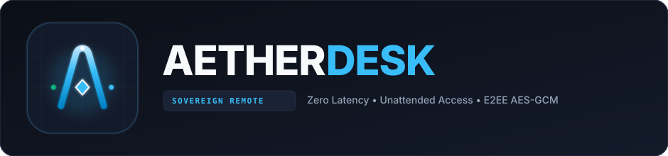

<p align="center">
  
</p>

<p align="center">
  <strong>Ultra-Light, Zero-Bloat Remote Access for Windows</strong><br>
  <em>Controlla a distanza il tuo PC fisso da qualsiasi portatile: 100% gratuito, ultra-veloce, zero abbonamenti.</em>
</p>

<p align="center">
  
  
  
  
</p>

<p align="center">
  <a href="https://github.com/ManuRoma02/AetherDesk/releases/latest/download/AetherDesk.exe">
    
  </a>
</p>

---

## ⚡ Cos'è AetherDesk?

**AetherDesk** è un'alternativa moderna, aperta e leggera a TeamViewer e AnyDesk progettata specificamente per Windows.
Nessun programma invasivo da centinaia di megabyte in background, nessun limite di tempo (mai più disconnessioni forzate dopo 5 minuti), nessun abbonamento a pagamento.

Un unico eseguibile autonomo portatile pronto su chiavetta USB e un servizio di sistema leggerissimo che si avvia prima del login Windows.

---

## ✨ Caratteristiche Principali

- 🛡️ **Accesso Non Presidiato (Unattended)**: Si avvia automaticamente all'accensione del PC fisso prima ancora del login utente (`SYSTEM / OnStart`). Puoi accendere il PC ed effettuare il login da remoto.
- 🔑 **Permessi Amministrativi Completi (UAC & Winlogon)**: Non si blocca mai sulle schermate di elevazione amministrativa (UAC) o schermate protette di Windows grazie all'aggancio dinamico a `OpenInputDesktop` e iniezione `SendInput`.
- ⚡ **Frame Differencing Ultra-Efficiente**: Rileva le differenze tra i fotogrammi a livello subpixel; a schermo fermo la trasmissione scende a quasi zero, abbattendo il consumo di banda e CPU di oltre l'**80%** (niente ventole al massimo sul portatile).
- 🔒 **Zero-Knowledge End-to-End Encryption (E2EE)**: Tutti i frame, comandi mouse/tastiera, appunti e file scambiati sono cifrati militarmente con **AES-256-GCM** e chiavi effimere derivate tramite **PBKDF2-SHA256**.
- 🖥️ **Supporto Multi-Monitor & Puntamento Precisione**: Passa al volo da *Monitor 1*, *Monitor 2* o visualizzazione aggregata *Tutti* con mappatura coordinate pixel-perfect su ogni display.
- 📦 **Trasferimento File in Streaming O(1) RAM**: Invia file e archivi pesanti senza saturare la memoria con barra di progressione percentuale in tempo reale.
- 📋 **Sincronizzazione Appunti Bidirezionale**: Copia e incolla istantaneo di testi, codice e comandi da e verso la macchina remota.
- 🌐 **Server Broker Integrato o Rete Locale**: L'Host può agire da server autonomo per la LAN/Wi-Fi (porta 8765) o connettersi tramite VPN sicura (Tailscale, ZeroTier, WireGuard).
- 📇 **Rubrica Dispositivi Salvati**: Salva più computer con nomi personalizzati per connetterti in un clic.

---

## 🚀 Guida Rapida

### 1. Sul PC Fisso (Host da controllare)

1. Avvia `start_host.bat` per aprire il **Pannello Host AetherDesk**.
2. Prendi nota del tuo **ID Dispositivo a 9 cifre** (es. `482 910 234`).
3. Imposta la tua password di accesso e clicca **Salva Password**.
4. **Server Locale Integrato**: L'opzione *"Avvia Server Broker Locale (Porta 8765)"* è attiva di default; l'host è subito pronto per ricevere connessioni.
5. **Per l'avvio automatico all'accensione del PC**:
   - Clicca con il tasto destro su `scripts\install_service.bat` e scegli **Esegui come amministratore** (oppure usa il pulsante *"Installa come Servizio Windows"* nel pannello).
   - Viene configurata un'attività di sistema pianificata ad avvio automatico (SYSTEM) che garantisce accesso prima del login Windows senza errori SCM 1053.

---

### 2. Sul Portatile (Client da cui controlli)

Puoi avviare il client in due modalità:
- **Metodo Standalone (.EXE)**: Fai doppio clic su `dist\AetherDesk.exe` (non richiede Python, funziona ovunque da chiavetta USB).
- **Metodo Script**: Fai doppio clic su `start_client.bat`.

Una volta aperta l'app:
1. Inserisci l'**ID del Computer Fisso** e la **Password**.
2. **Server Broker**:
   - In **rete locale / stesso Wi-Fi**: inserisci `ws://<IP_PC_FISSO>:8765` (es. `ws://192.168.1.50:8765`).
   - Tramite **VPN gratuita (es. Tailscale o ZeroTier)**: inserisci l'IP VPN del fisso (es. `ws://100.x.y.z:8765`).
   - Per test sullo stesso computer: lascia il default `ws://127.0.0.1:8765`.
3. Clicca su **Connetti al Computer**.

---

## 🏗️ Architettura di Sistema

```
┌─────────────────────────┐             Encrypted WebSocket             ┌─────────────────────────┐
│     AetherDesk Client   │ ◄─────────────────────────────────────────► │     AetherDesk Host     │
│  (Laptop / Portatile)   │             (Porta 8765 / WSS)              │   (PC Fisso / Server)   │
├─────────────────────────┤                                             ├─────────────────────────┤
│ • Canvas Direct Render  │   1. Handshake & PBKDF2 Session Key         │ • DesktopCapture (GDI)  │
│ • SendInput Key/Mouse   │   2. AES-256-GCM Encrypted MJPEG Frames     │ • OpenInputDesktop UAC  │
│ • Streaming File Reader │   3. Bidirectional Clipboard Loop           │ • SendInput Injection   │
│ • Device Address Book   │   4. Chunked O(1) File Receiver             │ • Sleep Prevention API  │
└─────────────────────────┘                                             └─────────────────────────┘
                                                ▲
                                                │
                                    ┌───────────────────────┐
                                    │   Signaling Broker    │
                                    │   (Host o Cloud P2P)  │
                                    └───────────────────────┘
```

---

## 💻 Compilazione Eseguibile (.EXE)

Per ricompilare il file autonomo con icona ufficiale:
```cmd
scripts\build_exe.bat
```
L'eseguibile pronto per la distribuzione viene salvato in `dist\AetherDesk.exe`.

---

## 🧪 Test Suite

Per verificare tutti i 37 test unitari, di rete e di crittografia:
```bash
python -m pytest tests/ -v
```
Tutti i **38 test unitari ed End-to-End** vengono eseguiti con esito 100% positivo.

---

## 📄 Licenza

Rilasciato sotto licenza MIT. Libero per uso personale, didattico e commerciale.
